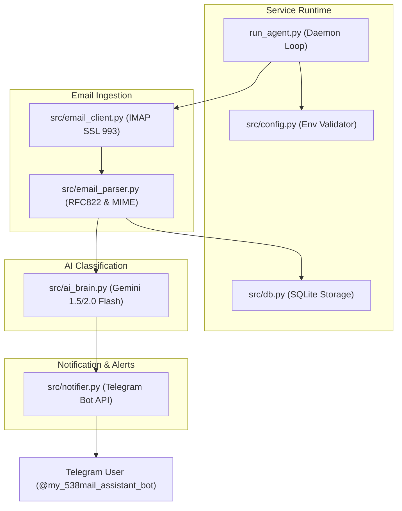

# Technical Architecture Plan: AI Email Agent

## 1. System Architecture Diagram



---

## 2. Component Design & Contracts

### 2.1 Database Schema (`data/emails.db`)
```sql
CREATE TABLE IF NOT EXISTS processed_emails (
    message_id TEXT PRIMARY KEY,
    sender TEXT,
    sender_name TEXT,
    subject TEXT,
    category TEXT,
    summary TEXT,
    has_attachment INTEGER DEFAULT 0,
    created_at TIMESTAMP DEFAULT CURRENT_TIMESTAMP
);
```

### 2.2 Gemini AI Structured Output Schema
```json
{
  "category": "client | relative | professional | urgent",
  "priority": "high | medium | low",
  "summary": "বাংলায় মূল বিষয়বস্তুর সংক্ষেপ (১-২ লাইন)",
  "suggested_reply": "যদি ক্লায়েন্ট হয়, তবে প্রফেশনাল ও নির্ভুল ড্রাফট রিপ্লাই। অন্যথায় ফাঁকা।"
}
```

### 2.3 Telegram Notification Formats
- **Client Template**:
  ```markdown
  📩 *নতুন ক্লায়েন্ট ইমেইল এসেছে!*
  
  👤 *প্রেরক:* {name} ({email})
  📌 *বিষয়:* {subject}
  📎 *সংযুক্তি:* {attachment_info}
  
  📝 *সারসংক্ষেপ:*
  {summary}
  
  ✍️ *প্রস্তাবিত ড্রাফট রিপ্লাই:*
  _{suggested_reply}_
  ```

- **Friend/Relative Template**:
  ```markdown
  💌 *আপনার বন্ধু বা রিলেটিভ একটি মেইল পাঠিয়েছেন!*
  
  👤 *প্রেরক:* {name} ({email})
  📌 *বিষয়:* {subject}
  
  📝 *সারসংক্ষেপ:*
  {summary}
  ```

---

## 3. Resilience & Failure Handling
- **IMAP Connection Loss**: Exponential backoff retry (5s, 15s, 30s, up to 60s).
- **Gemini Rate Limit / Timeout**: Falls back to logging and retries on next poll cycle without marking email as processed.
- **Telegram Timeout**: Retries up to 3 times before moving forward.
