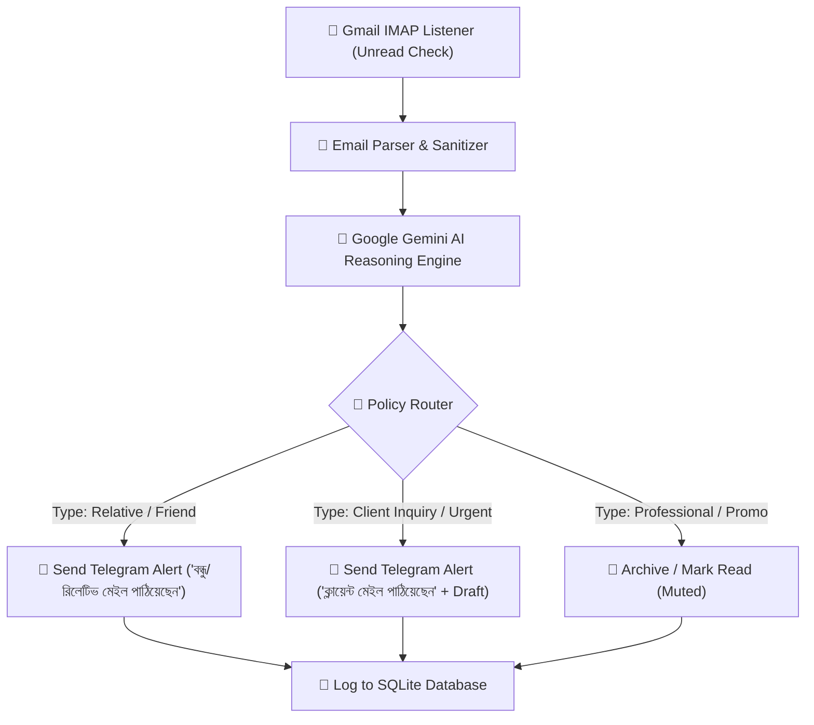

# Specification: Autonomous AI Email Agent

## 1. Executive Summary
An autonomous Python-based Email Automation Agent that connects directly to Gmail via IMAP/SMTP using a Google App Password. The agent monitors unread incoming emails, analyzes intent and sender relationship using Google Gemini AI, takes policy-based actions (auto-replying, moving/labeling, or escalating to human), and sends real-time rich Telegram alerts when client attention is needed.

---

## 2. Architecture & Workflow



---

## 3. Email Classification & Action Matrix

| Category | Description | Agent Action | Notification |
| :--- | :--- | :--- | :--- |
| **`client`** | Potential or active clients, project inquiries, pricing, support | Do NOT auto-reply. Save state & prepare recommended reply draft. | **Immediate Telegram Alert** ("ক্লায়েন্ট ইমেইল পাঠিয়েছেন" with sender, summary, and suggested draft). |
| **`relative`** | Family, friends, personal contacts | Do NOT auto-reply. Categorize & log. | **Immediate Telegram Notification** ("আপনার বন্ধু বা রিলেটিভ একটি মেইল পাঠিয়েছেন" with sender and summary). |
| **`professional`** | Cold outreach, newsletters, receipts, notifications, ads | Archive or mark read. No reply sent. | **Muted (No Alert)** |
| **`urgent`** | High-priority security alerts, critical account notices | Flag as urgent. | **High-Priority Telegram Alert** |

---

## 4. Technical Stack

- **Language**: Python 3.10+ (Standard Library: `imaplib`, `smtplib`, `email`, `sqlite3`)
- **AI Engine**: Google Gemini API (`google-genai` / HTTP request with `gemini-1.5-flash` or `gemini-2.0-flash`)
- **Notification**: Telegram Bot API (`https://api.telegram.org/bot<TOKEN>/sendMessage`)
- **Persistence**: Local SQLite database (`data/emails.db`) to ensure idempotency (no email is ever processed twice)
- **Configuration**: Environment variables via `.env` (Secure: no credentials hardcoded in code)

---

## 5. Directory Structure

```
/home/sharif/projects/Email automation/
├── .env                  # Secure credentials (Gmail, Gemini, Telegram)
├── .env.example          # Template for environment variables
├── requirements.txt      # Python dependencies
├── specs/
│   └── email_agent_spec.md
├── src/
│   ├── __init__.py
│   ├── config.py         # Loads & validates environment variables
│   ├── db.py             # SQLite database manager for processed email tracking
│   ├── email_client.py   # IMAP fetcher & SMTP sender
│   ├── ai_brain.py       # Gemini AI classifier & response generator
│   ├── notifier.py       # Telegram notification dispatcher
│   └── agent.py          # Main agent loop & orchestrator
├── run_agent.py          # Main entrypoint
├── start.sh              # Background runner script
└── stop.sh               # Graceful shutdown script
```

---

## 6. Security & Safety Principles
1. **Zero Hardcoded Secrets**: All passwords, API keys, and tokens live strictly in `.env`.
2. **Idempotency**: Every email's `Message-ID` is indexed in SQLite before action to avoid duplicate replies or notifications.
3. **Safety Fallback**: If AI confidence is low or classification fails, the email defaults to `client` escalation (safe human alert) rather than sending an erroneous auto-reply.
